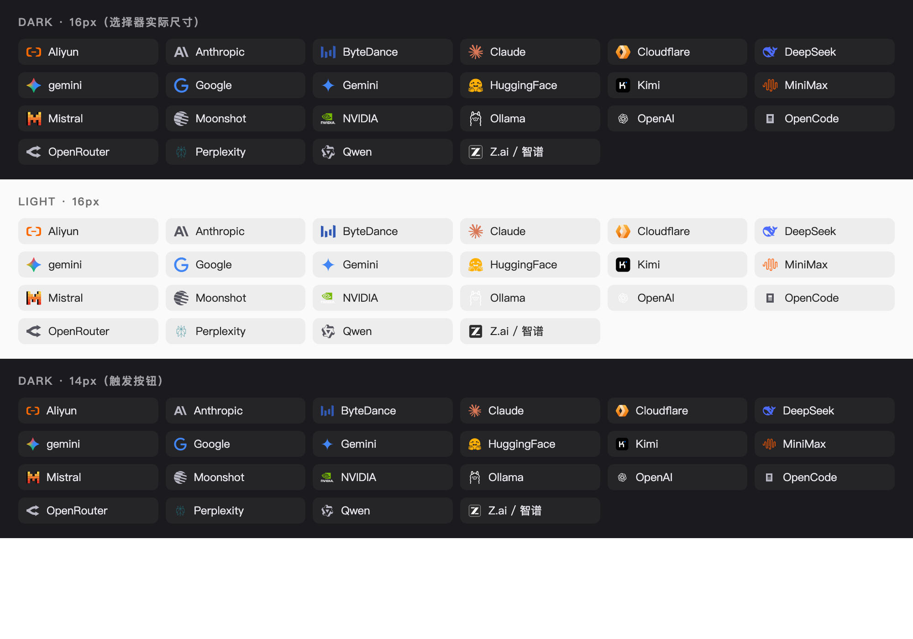

# dsh-model-picker-brand

**Provider logos + model IDs in the DeepSeek Harness model picker.**

The composer's model picker normally shows one line of text — `DeepSeek-V4.1-Flash`. This plugin puts
a **brand logo** in front of every model and adds the **model ID** beside the name, so you can tell at
a glance which provider a model belongs to and which exact route you are on.

Zero core changes: it registers a label decorator on the official
`conversation.input.model.label` slot. Disable the plugin and the picker is exactly as shipped.



## What changes

| Where | Before | After |
| --- | --- | --- |
| Composer trigger button | `DeepSeek-V4.1-Flash` | `[logo] deepseek-flash` (compact, ID first) |
| Menu "Model" row | `DeepSeek-V4.1-Flash` | `[logo] DeepSeek-V4.1-Flash  deepseek-flash` |
| Model list items | `DeepSeek-V4.1-Flash` | `[logo] DeepSeek-V4.1-Flash  deepseek-flash` |
| Unknown provider | plain text | first-letter monogram in a colored chip |

Hovering any label shows `name · id` as a title.

## Install

From npm (recommended — the market index reads npm versions):

```sh
dsh plugin --profile web add dsh-model-picker-brand
```

Straight from the repository:

```sh
dsh plugin --profile web add github:zhangyongshuai56-hub/dsh-model-picker-brand
```

Restart (or hot-reload) the host once. Remove the bundle entry to uninstall — nothing else is written.

Requirements: `dsh >= 0.2.1-rc.2`. No build step, no runtime dependencies.

## 中文说明

输入框模型选择器从「纯文本模型名」改为「提供商彩色 logo + 模型 ID」：触发按钮显示
`[logo] 模型ID`，菜单项与列表项显示 `[logo] 名称 + 灰色模型 ID`。零内核改动——只往官方插槽
`conversation.input.model.label` 注册标签装饰器（priority −10 接管渲染），停用插件即恢复原样。

安装：`dsh plugin --profile web add dsh-model-picker-brand`（或 `github:zhangyongshuai56-hub/dsh-model-picker-brand`），重启生效。

## How it works

The official picker renders every model label through a slot:

```js
renderSlot("conversation.input.model.label",
           { provider, model, placement, selected },
           { fallback: model.name })
```

`placement` is `"trigger" | "menu" | "option"`. This plugin registers a decorator on that slot at
**priority −10**; the slot registry renders the lowest priority, so it takes over the label without
touching `@deepseek-ai/dsh-client-ui-model-selection`. The official badge plugin
(`dsh-client-ui-deepseek-model-label-1017`) also registers at priority 0 and is shadowed while this
plugin is enabled — disable this plugin and it comes back untouched.

Every label is wrapped in a `try/catch`: any unexpected shape falls back to `model.name`, so the
picker can never fail to render because of this plugin.

## Brand matching

A flat `id → icon` table breaks the moment a provider ships a second id (`zhipu` / `z-ai` / `glm` /
`zcode` are the same vendor). Matching is registry-driven instead — each brand carries three kinds of
clues, tried by confidence:

| Order | Clue | Examples |
| --- | --- | --- |
| 1 | **override** (localStorage) | `{"some-new-provider":"zhipu"}` — no code change needed |
| 2 | **token** on `provider.id` | `zhipu` `zhipuai` `z-ai` `zai` `glm` `zcode` `bigmodel` `chatglm`; split on separators, longer tokens first |
| 3 | **name** on `provider.name` (Chinese included) | `智谱` `智谱清言` `通义千问` `月之暗面` `阿里云` `豆包` |
| 4 | **model** prefix (weakest) | `glm-4.6` → Zhipu, `claude-3-7` → Claude, `gpt-4o` → OpenAI, `gemini-2.5` → Gemini |
| 5 | no match | first-letter monogram — never another vendor's logo |

Fix a provider without waiting for a release:

```js
localStorage.setItem('dsh.model-picker-brand.overrides', JSON.stringify({ 'my-provider': 'zhipu' }))
```

Debug from the browser console: `dshModelPickerBrand.resolve({ id: 'zai' })`.

## Assets and theming

22 brands: colored vectors from [svgl](https://svgl.app), with [simple-icons](https://simple-icons.org)
(CC0) filling the gaps. All trademarks belong to their owners; the marks are used only to identify the
service a model comes from.

- **Monochrome marks** (Anthropic, OpenAI, Ollama, Qwen, OpenRouter) become `currentColor` and follow
  the light/dark theme.
- **Colored marks** (DeepSeek, Claude, Gemini, Mistral, NVIDIA, Kimi, Cloudflare) keep their real
  colors; white details stay white, so a blue tile with a white glyph does not turn into a black blob.
- **Z.ai / Zhipu** uses the official logo from z.ai (`#2D2D2D` tile + white hairline + white Z). The
  hairline is what keeps it readable on dark themes at 14px.
- Root `<svg>` fill/stroke are pushed down into a `<g>`; gradient IDs are namespaced per brand so
  inline SVGs cannot repaint each other.

## Development

```sh
npm test    # 42 cases: id variants, Chinese names, model inference, fallback, overrides
```

The test loads `lib/client.js` through a stub `ModuleLoader`, then asserts the resolver — offline, no
host required.

```
lib/index.js        host half — one status route (/dsh-model-picker-brand/status)
lib/client.js       browser half — the label decorator and bundled vectors
cordis.patch.yml    bundle patch that mounts the plugin
tests/resolve.test.mjs
```

## License

MIT. Brand marks remain the property of their respective owners.
